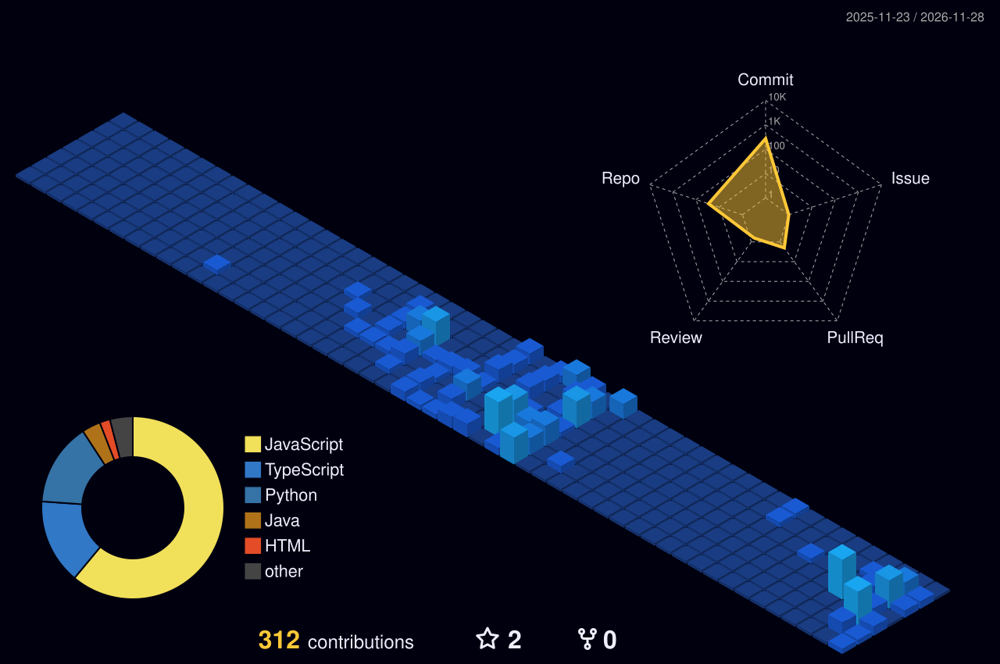

<h1 align="center">Hi 👋, I'm Samyak Jain</h1>

<h3 align="center">Full-Stack &amp; Agentic AI Engineer · MERN · Python · LangGraph · RAG</h3>

  
  
  
  

---

# 💫 About Me

CS graduate (B.Tech, 2026) from Indore building end-to-end, production-ready software. I work across the **MERN stack** and **agentic AI**: multi-agent systems with **LangChain and LangGraph**, **RAG** pipelines, and agent memory, backed by **FastAPI** and **Node.js** services.

As a freelance full-stack developer I own the whole loop with clients: requirements, architecture, deployment. No PM layer in between.

Open to **AI / Agentic AI Engineer, Full-Stack, and Forward Deployed Engineer** roles (fresher), remote or anywhere in India. Also open to freelance and open-source collaboration.

---

# 🚀 What I'm Up To

🔭 **Building:** agentic AI apps with evals, local-model support, and open-source tooling

🌱 **Learning:** system design, advanced DSA, scalable full-stack architecture, production-grade code quality

👯 **Collaborating on:** GenAI / agentic projects, open source, hackathon builds

💬 **Ask me about:** React, Node.js, FastAPI, LangGraph, RAG, MongoDB, Socket.IO, Gemini API

---

# 📅 My 2026 Contribution Skyline

  

---

# 💻 Tech Stack

### Languages

### Frontend

### Backend

### Databases

### AI / Agentic

### Cloud & Tools

---

# 📌 Featured Projects

## 🎤 Abhyas: Voice-First AI Mock Interview Agent
Free, open-source (MIT) mock interview agent. Voice-first, bring-your-own-key, with support for local models.
**Stack:** TypeScript · LLM APIs / local models
💻 [GitHub](https://github.com/Samyak9109/Abhyas)

## 🍔 Munchy: Full-Stack Food Ordering Platform
Food ordering and discovery with auth, partner features, and an AI chatbot.
**Stack:** React · Node.js · Express · MongoDB · Tailwind · LangChain · Gemini
🔗 [Live](https://munchyfoodpickup.netlify.app/) · 💻 [GitHub](https://github.com/Samyak9109/Munchy-Food-App)

## 🏙️ CivicAI: Hyperlocal Civic-Issue Platform
Six-agent Gemini pipeline: vision-based issue detection, duplicate detection, prioritisation, verification, resolution, insights.
**Stack:** React · TypeScript · Express · Docker

## 🧠 RAG Customer Support Agent
Retrieval-augmented support agent with hybrid retrieval.
**Stack:** FastAPI · Qdrant · PostgreSQL · Mistral · React
💻 [GitHub](https://github.com/Samyak9109/rag-support-agent)

## 💼 Job Copilot: Career-Memory App
Career assistant with persistent memory over your experience and job targets.
**Stack:** FastAPI · MongoDB · LangChain · React/Vite
💻 [GitHub](https://github.com/Samyak9109/job-copilot)

## 🎨 Scribbl: Real-Time Collaborative Whiteboard
Live multi-user drawing rooms with shapes and text.
**Stack:** React · Redux Toolkit · Socket.IO · Express · Canvas API
🔗 [Live](https://skribbl-draw.netlify.app/) · 💻 [GitHub](https://github.com/Samyak9109/Scribbl)

➡️ More on [my repositories](https://github.com/Samyak9109?tab=repositories): LexPilot, ElectraGuide, EcoTrackAI, FaceRoll, score-agent, and more.

---

# 🎓 Certifications & Honors

- Complete Agentic AI Bootcamp with LangGraph and LangChain, Udemy (Krish Naik), Jun 2026
- Meta Full Stack Developer: Front-End & Back-End from Scratch, Coursera, May 2026
- Programming in Python, Meta via Coursera, May 2026
- Top 300 of 5,000+ participants, Google Prompt Wars Virtual Hackathon
- 100+ DSA problems solved on LeetCode

---

# 🌐 Connect

  
  
  
  

<b>Thanks for visiting! ⭐</b>

